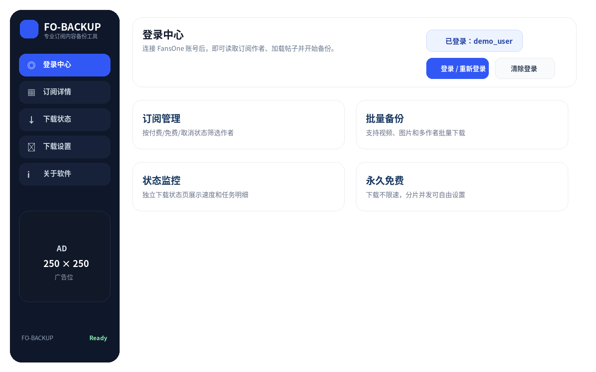
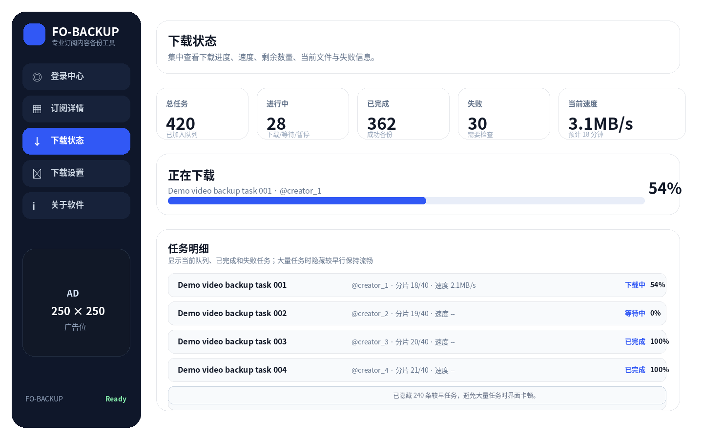
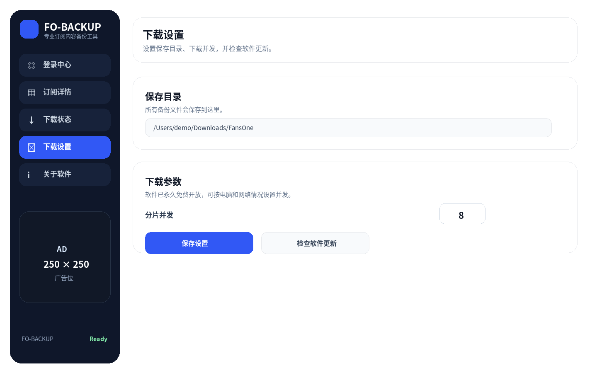
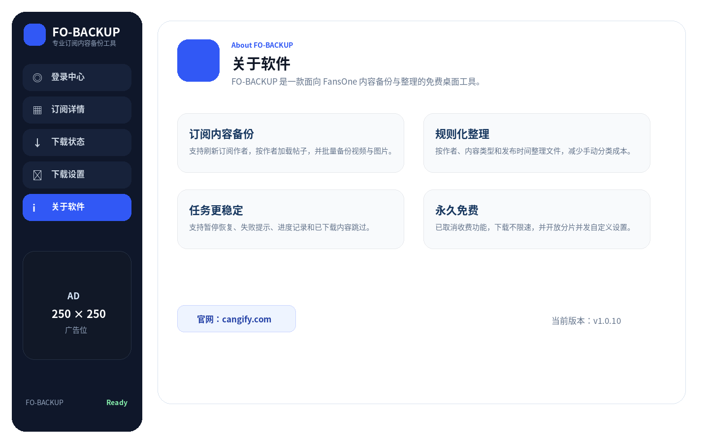

# Fansone Downloader Backup / FansOne 内容下载备份工具

> **Unofficial HLS repair fork:** This fork retains the history of [cangify/Fansone-Downloader-Backup](https://github.com/cangify/Fansone-Downloader-Backup) and adds `1.0.10-local.1`. It fixes fragmented MP4 initialization, independent audio, media validation, and retry/pause handling. See [repair notes and tests](docs/hls-repair.md) and [prebuilt repair packages](https://github.com/22pro/Fansone-Downloader-Backup/releases/tag/v1.0.10-local.1). The packages are not Developer ID/Authenticode signed; Windows runtime testing is pending.
>
> **非官方 HLS 修复分支：** 保留原项目历史，加入 `1.0.10-local.1` 修复，处理初始化段、独立音轨、成品校验与重试/暂停。详见[修复说明和测试](docs/hls-repair.md)。上游 `v1.0.10` 安装包不包含此补丁；修复版安装包（Mac Apple Silicon、Windows x64）已在 [v1.0.10-local.1 Release](https://github.com/22pro/Fansone-Downloader-Backup/releases/tag/v1.0.10-local.1) 提供，含 SHA-256 校验清单。包未做官方开发者签名，Windows 未实机验证，当前标记为预发布版。

**Fansone Downloader Backup** is a free desktop tool for backing up FansOne videos and images that your own account is allowed to access.

**Fansone Downloader Backup** 是一款免费的 FansOne 内容下载与备份工具，用于将你自己的账号已订阅、已授权访问的视频和图片保存到本地。

Homepage / 官网：https://cangify.com

> Use this tool only for FansOne content that your own account is allowed to access. It is intended for personal backup, archiving, and content management.
>
> 请仅用于备份你自己的账号有权限访问的 FansOne 内容。本工具适合个人备份、资料归档和内容整理。

## Upstream Version / 上游版本

**v1.0.10**

- Free version: paid membership and payment features have been removed.
- No built-in free-plan speed limit.
- Download concurrency can be configured in the app.
- Improved responsiveness for large download queues, especially 400+ videos.

---

- 免费版本：已移除会员收费和支付功能。
- 不再内置免费版限速。
- 下载并发可在软件中自行设置。
- 优化大量下载任务的界面响应，尤其是 400+ 视频任务场景。

## Main Features / 主要功能

- Log in with your FansOne account and load accessible subscriptions, creators, and posts.
- Back up videos and images that your account can normally view/access.
- Select creators and posts, then batch download selected content.
- Download video segments with resume support, progress display, speed display, and task logs.
- Optimized task monitor for large queues to reduce UI freezing.
- Merge downloaded video segments and package them as MP4 when possible.
- Configure the local output folder and download concurrency.
- Chinese / English interface.
- Windows and macOS packages.

---

- 支持登录 FansOne 账号后读取可访问的订阅、作者和帖子内容。
- 支持备份当前账号可正常查看和访问的视频、图片资源。
- 支持按作者、帖子选择内容，并批量下载选中的资源。
- 支持视频分片下载、断点续传、下载进度、实时速度和任务日志显示。
- 下载状态页已针对大量任务优化，减少界面卡顿。
- 视频分片下载完成后会自动合并，并尽可能封装为 MP4。
- 支持自定义本地保存目录和下载并发。
- 支持中文 / 英文界面。
- 提供 Windows 与 macOS 版本。


## Screenshots / 软件截图

### Login Center / 登录中心



### Large Download Queue / 大批量下载状态



### Download Settings / 下载设置



### About / 关于软件



## Download / 下载

Please download the latest version from the GitHub Releases page:

请在 GitHub Releases 页面下载最新版：

- Windows x64 Installer: `FansOneDownloader-1.0.10-x64-installer.exe`
- Windows x64 Portable: `FansOneDownloader-1.0.10-x64-portable.exe`
- macOS Intel x64: `FansOneDownloader-1.0.10-mac.zip`
- macOS Apple Silicon arm64: `FansOneDownloader-1.0.10-arm64-mac.zip`
- Checksums: `SHA256SUMS-1.0.10.txt`

## Usage / 使用方法

1. Open the app and click **Login / Re-login**.
2. Sign in manually in the FansOne login window.
3. Return to the main window and refresh subscriptions.
4. Select a creator and load posts.
5. Select the videos or images you want to back up, then start the download task.
6. After completion, open the configured output folder to view the backup files.

---

1. 打开软件，点击「登录 / 重新登录」。
2. 在弹出的 FansOne 登录窗口中手动登录账号。
3. 回到主窗口点击「刷新订阅」。
4. 选择作者并加载帖子。
5. 勾选需要备份的视频或图片，点击「下载选中」。
6. 下载完成后，在设置的保存目录中查看备份文件。

## Notes / 说明

- macOS packages may be unsigned. If blocked on first launch, right-click the app and choose **Open**, or allow it in **System Settings → Privacy & Security**.
- The default output folder is `FansOne` under your system Downloads directory, unless you choose another folder in the app.
- Video files are downloaded in segments first, then merged after all required segments are complete.
- For very large batches, the task list may hide older rows to keep the app responsive; the summary counts still include all tasks.

---

- macOS 包可能未进行 Apple 签名。如果首次打开被系统拦截，可右键选择“打开”，或到“系统设置 → 隐私与安全性”中允许打开。
- 默认保存位置是系统下载目录下的 `FansOne` 文件夹，也可以在软件中自行选择其他目录。
- 视频会先按分片下载，所有必要分片完成后再自动合并。
- 大批量任务时，任务列表可能隐藏较早的行以保持软件流畅；顶部统计仍包含全部任务。

## Important / 重要提醒

- You need to log in with a FansOne account that has access to the target content.
- The tool cannot download content that your account cannot access.
- The tool does not bypass DRM or encrypted protection.
- Please follow FansOne rules, local laws, and the rights of content owners.
- This project is intended for backup and archiving, not for unauthorized access or redistribution.

---

- 你需要登录一个有权限访问目标内容的 FansOne 账号。
- 如果你的账号本身无法访问某个作者、帖子或资源，本工具也不能下载。
- 软件不会绕过 DRM 或加密保护。
- 请遵守 FansOne 规则、当地法律法规以及内容所有者权益。
- 本项目用于备份和归档，不用于未授权访问或二次传播。

## Development / 本地开发

```bash
npm install
npm start
```

Syntax check / 语法检查：

```bash
npm run test:syntax
```

Full regression tests (Node.js 22+ and system FFmpeg/ffprobe required) / 完整回归测试（需要 Node.js 22+ 和系统 FFmpeg/ffprobe）：

```bash
npm test
```

## Build / 打包

Windows:

```bash
npm run dist:win
```

macOS zip:

```bash
npx electron-builder --mac zip --x64 --arm64 --publish never
```

Build outputs are generated in `dist/` by default.

构建产物默认输出到 `dist/`。

## License

ISC
